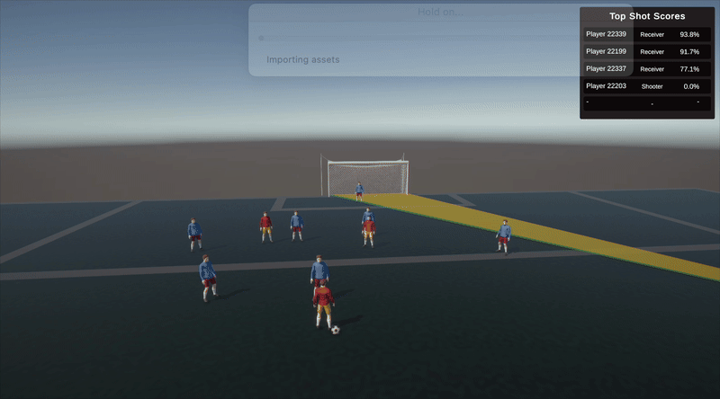

# Football Shot Simulation

A Unity-based football simulation that recreates real match scenarios and evaluates passing and shooting opportunities using player positioning and geometric analysis.

**Tech Stack:** Unity · C# · CSV/JSON · ScriptableObjects

## Demo

  
  

## Overview

Football Shot Simulation is a Unity-based simulation I independently developed as part of my Computer Engineering graduation project.

The simulation uses player-position data from real football matches, originally stored in CSV files. These coordinates are transformed into Unity world positions to reconstruct realistic match situations on a 105 × 68-meter football pitch.

Based on player positioning, the system evaluates passing options, analyzes shooting opportunities, and visualizes the results in an interactive 3D environment.

## Key Features

- **Real Match Data Integration:** Reconstructs football scenarios using player positions derived from real match data.
- **Player & Ball Simulation:** Dynamically creates and updates players and the ball using structured match snapshots.
- **Passing Evaluation:** Identifies available passing options by checking whether passing lanes are blocked.
- **Shot Evaluation:** Calculates shooting openness using geometric analysis of player positions and goal visibility.
- **Visualization & UI:** Visualizes passing and shooting opportunities alongside player-based shot scores.
- **Modular Architecture:** Organizes simulation, evaluation, and visualization into reusable C# components, prefabs, and ScriptableObjects.

## How It Works

1. Player-position data from real match CSV files is prepared as structured JSON snapshots.
2. Pitch coordinates are mapped into Unity world coordinates.
3. Player and ball objects are created or updated to reconstruct each scenario.
4. Geometric evaluation algorithms analyze passing lanes and shooting openness.
5. The results are visualized through player actions, shot indicators, and an in-game UI.

## Development

I independently designed and implemented the Unity simulation component of our graduation project, including:

- Unity scene setup and simulation architecture.
- Player spawning, positioning, and ball movement.
- Integration of structured match data and coordinate mapping.
- Passing and shooting evaluation systems.
- Gameplay visualization and user interface components.
- Reusable C# scripts, prefabs, and configurable ScriptableObjects.

## Project Context

This simulation was developed as part of a larger Computer Engineering graduation project at TOBB University of Economics and Technology (TOBB ETÜ).

The overall graduation project was a team effort, while the Unity simulation presented in this repository was independently developed by me.

**Graduation Project Team:** Mahmut Milayim, Fatma Zehra Atalay, Samet Bozdoğan, Alper Burak Doğan.
